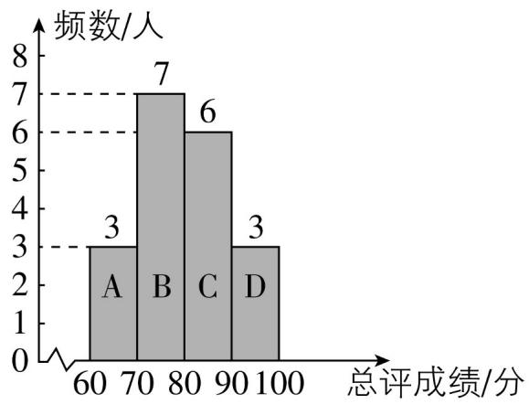

> [!success]- 必刷题
>
> > [!success] **【答案】** 84,85
>
> > [!note]- **【解析】**
> > 【解】(1)①由题中表2可知,2号选手的评委评分中,出现次数最多的是84分,故众数为84分,平均数为 $\frac{1}{5}\times(85+84+84.5+84+87.5)=85$ (分).故答案为84,85.
> > - **②**：$s_{1}^{2}=\frac{1}{5}\times\left[(85-85)^{2}+(80-85)^{2}+(83-85)^{2}+(90-85)^{2}+(87-85)^{2}\right]=11.6,\quad s_{2}^{2}=\frac{1}{5}\times\left[(85-85)^{2}+(84-85)^{2}+(84.5-85)^{2}+(84-85)^{2}+(87.5-85)^{2}\right]=1.7$ ,所以 $s_{1}^{2}>s_{2}^{2}$ .
> > (2) 2 号选手的总评成绩为 $86 \times 50\% + 80 \times 30\% + 85 \times 20\% = 84$ (分)
> >
> > $$
> > \quad 30 \% + 85 \times 20 \% = 84 (\text{分})
> > $$
> >
> > (3)①C 组人数为 $19 - 3 - 7 - 3 = 6$ (人), 补充完整总评成绩频数直方图如下:
> >
> > 关键点拨
> > 本题考查中位数,理解题意,掌握确定中位数的方法是解题的关键.
> >
> > 
> > - **②**：1号选手没有入选,2号选手入选. 理由:由总评成绩频数分布直方图可得择优选拔的9名广播员的总评成绩应在 C: $80 \leqslant x < 90$ ; D: $90 \leqslant x \leqslant 100$ 两组内,而1号选手的总评成绩为79.5分,不在C、D两组范围内,2号选手的总评成绩为84分,在C组范围内,所以1号选手没有入选,2号选手入选.
> >
> > 关键点按按要求分组，分别计算出组内离差平方和并比较大小是解题的关键.
