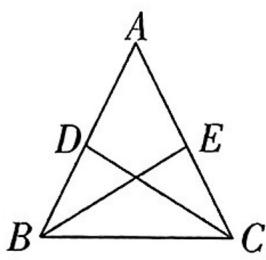

<!-- question-source:start -->
1 [2023 浙江台州中考] 如图, 锐角三角形 $ABC$ 中, $AB = AC$ , 点 $D, E$ 分别在边 $AB, AC$ 上, 连接 $BE, CD$ . 下列命题中, 假命题是 ( )

A. 若 $CD = BE$ , 则 $\angle DCB = \angle EBC$ B. 若 $\angle DCB = \angle EBC$ , 则 $CD = BE$ C. 若 $BD = CE$ , 则 $\angle DCB = \angle EBC$ D. 若 $\angle DCB = \angle EBC$ , 则 $BD = CE$

<!-- question-source:end -->

![[Q00106289A1]]
