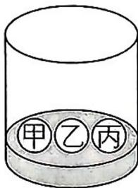

<!-- question-source:start -->
3[2024 四川宜宾中考]如图,一个圆柱体容器,其底部有三个完全相同的小孔槽,分别命名为甲槽、乙槽、丙槽.有大小质地完全相同的三个

小球,每个小球标有从1至9中选取的一个数字,且每个小球所标数字互不相同.作如下操作:将这三个小球放入容器中,摇动容器使这三个小球全部落入不同的小孔槽(每个小孔槽只能容下一个小球),取出小球记录下各小孔槽的计分(分数为落入该小孔槽小球上所标的数字),完成第一次操作.再重复以上操作两次.已知甲槽、乙槽、丙槽三次操作计分之和分别为20分、10分、9分,其中第一次操作计分最高的是乙槽,则第二次操作计分最低的是\_\_\_\_(从“甲槽”“乙槽”“丙槽”中选填).
<!-- question-source:end -->

![[Q00106291A1]]
