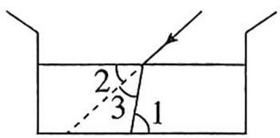
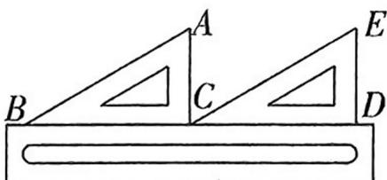

<!-- question-source:start -->
4 新考向图学科综合 [2024 四川达州中考] 当光线从空气射入水中时, 光线的传播方向发生了改

建议用时-20分钟 答案-D76

变, 这就是光的折射现象(如图所示). 图中 $\angle 1 = 80^{\circ}, \angle 2 = 40^{\circ}$ , 则 $\angle 3$ 的度数为 ( )
A. $30^{\circ}$ B. $40^{\circ}$ C. $50^{\circ}$ D. $70^{\circ}$

(第4题图)

(第5题图)
<!-- question-source:end -->

![[Q00106292A1]]
