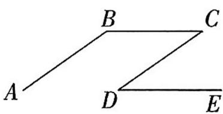
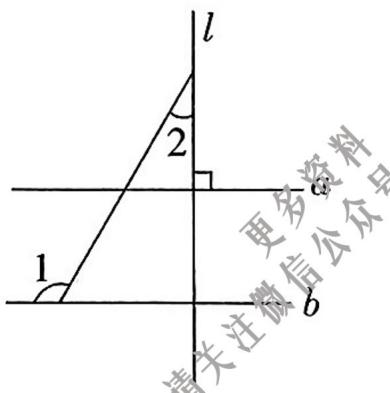

<!-- question-source:start -->
6[2024 陕西中考]如图, $AB \parallel DC$ , $BC \parallel DE$ , $\angle B = 145^{\circ}$ , 则 $\angle D$ 的度数为 ( )
A. $25^{\circ}$ B. $35^{\circ}$ C. $45^{\circ}$ D. $55^{\circ}$

(第6题图)

(第7题图)
<!-- question-source:end -->

![[Q00106294A1]]
