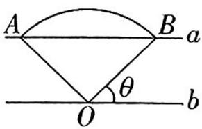

<!-- question-source:start -->
8[2024 四川绵阳中考]如图, 直线 $a//b$ , 点 $O$ 在 $b$ 上, 以 $O$ 为圆心画弧, 交 $a$ 于不同两点 $A, B$ . 若 $\theta = 44^{\circ}$ , 则 $\angle AOB =$ \_\_\_\_°.

<!-- question-source:end -->

![[Q00106296A1]]
