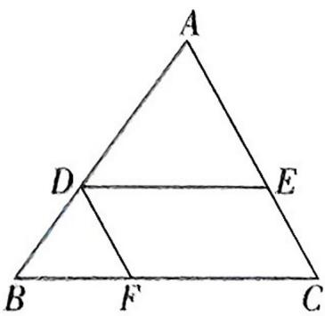

<!-- question-source:start -->
9[2024 四川自贡中考]如图,在 $\triangle ABC$ 中, $DE \parallel BC$ , $\angle EDF = \angle C$ .

(1) 求证: $\angle BDF = \angle A$ ;

(2) 若 $\angle A = 45^{\circ}$ , $DF$ 平分 $\angle BDE$ , 请直接写出 $\triangle ABC$ 的形状.

<!-- question-source:end -->

![[Q00106297A1]]
