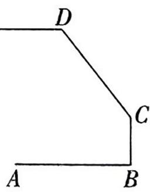

<!-- question-source:start -->
9[2025 四川成都期末]某公司 $E_{\text{推}}$ 出的护眼灯其侧面示意图 (台灯底座高度忽略不计) 如图所示, 其中 $BC \perp AB$ , $ED \parallel AB$ , 经使用发现, 当 $\angle DCB =$

142°时,台灯光线最佳,则此时∠EDC的度数为\_\_\_\_.
<!-- question-source:end -->

![[Q00106305A1]]
