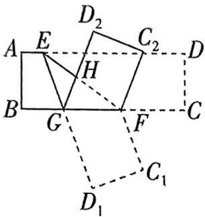

<!-- question-source:start -->
10[2025 湖北武汉期末]如图, 将长方形纸片 ABCD 沿 EF 折叠(折痕 EF 交 AD 于 E, 交 BC 于 F), 点 C, D 的对应点分别是 $C_{1}, D_{1}, ED_{1}$ 交 BC 于 G, 再将四边形 $C_{1}D_{1}GF$ 沿 FG 折叠, 点

$C_{1}, D_{1}$ 的对应点分别是 $C_{2}, D_{2}, GD_{2}$ 交 EF 于 H. 给出下列结论: ① $\angle EGD_{2} = \angle EFG$ ; ② $2\angle EFC = \angle EGC + 180^{\circ}$ ; ③ 若 $\angle FEG = 26^{\circ}$ , 则 $\angle EFC_{2} = 102^{\circ}$ ; ④ $\angle FHD_{2} = 3\angle EFB$ . 上述结论正确的是 \_\_\_\_. (填序号)

<!-- question-source:end -->

![[Q00106306A1]]
