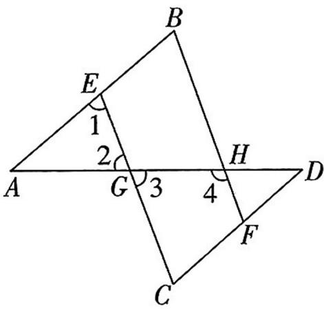

<!-- question-source:start -->
11 如图, 点 $B, C$ 在线段 $AD$ 的异侧, 点 $E, F$ 分别是线段 $AB, CD$ 上的点, 已知 $\angle 1 = \angle 2$ , $\angle 3 = \angle C$ .

(1) 求证: $AB \parallel CD$ ;

(2) 若 $\angle 2 + \angle 4 = 180^{\circ}$ , 求证: $\angle BFC + \angle C = 180^{\circ}$ ;

(3) 在 (2) 的条件下, 若 $\angle BFC - 30^{\circ} = 2 \angle 1$ , 求 $\angle B$ 的度数.

<!-- question-source:end -->

![[Q00106307A1]]
