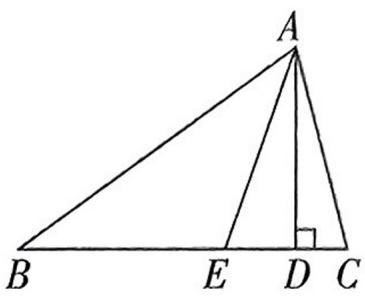
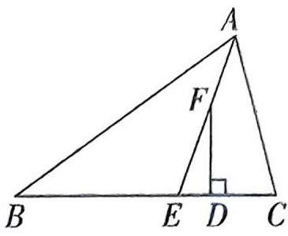

<!-- question-source:start -->
12 在 $\triangle ABC$ 中, $\angle C > \angle B, AE$ 平分 $\angle BAC$ .

(1)如图(1), $AD \perp BC$ 于 $D$ , 若 $\angle C = 75^{\circ}$ , $\angle B = 35^{\circ}$ , 求 $\angle EAD$ 的度数.

(2)如图(1), $AD \perp BC$ 于 $D$ , 判断 $\angle EAD = \frac{1}{2} (\angle C - \angle B)$ 是否成立, 并说明你的理由.

(3)如图(2), $F$ 为 $AE$ 上一点, $FD \perp BC$ 于 $D$ , 这时 $\angle EFD$ 与 $\angle B, \angle C$ 又有什么数量关系? (不用证明)

图(1)

图(2)

<!-- question-source:end -->

![[Q00106308A1]]
