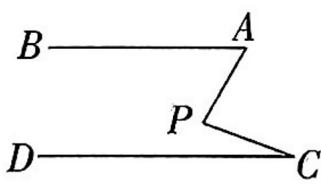
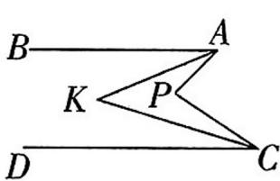
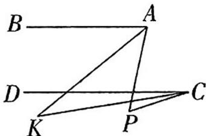

<!-- question-source:start -->
13[2024 广东深圳罗湖区期末]已知直线 $AB \parallel DC$ , 点 $P$ 为平面上一点, 连接 $AP$ 与 $CP$ .

(1) 如图 (1), 点 $P$ 在直线 $AB, CD$ 之间, 当 $\angle BAP = 60^{\circ}, \angle DCP = 20^{\circ}$ 时, 求 $\angle APC$ 的度数.

(2) 如图 (2), 点 $P$ 在直线 $AB, CD$ 之间, $\angle BAP$ 与 $\angle DCP$ 的平分线相交于点 $K$ , 写出 $\angle AKC$ 与 $\angle APC$ 之间的数量关系, 并说明理由.

(3) 如图 (3), 点 $P$ 在 $CD$ 下方, $\angle BAP$ 与 $\angle DCP$ 的平分线相交于点 $K$ , $\angle AKC$ 与 $\angle APC$ 有何数量关系? 并说明理由.

图(1)

图(2)

图(3)

电子错题本鸭
<!-- question-source:end -->

![[Q00106309A1]]
