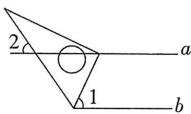
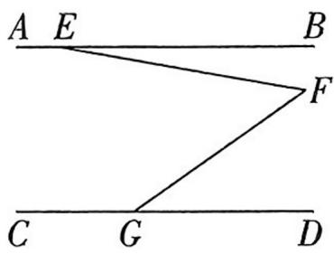

<!-- question-source:start -->
1. 将含 $30^{\circ}$ 角的直角三角尺如图摆放, 直线 $a / / b$ , 若 $\angle 1 = 65^{\circ}$ , 则 $\angle 2$ 的度数为 ( )
A. $45^{\circ}$ B. $50^{\circ}$ C. $55^{\circ}$ D. $60^{\circ}$

(第1题图)
(第 4 题图)
<!-- question-source:end -->

![[Q00106418A1]]
