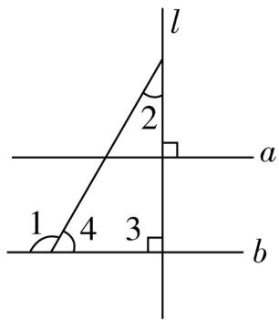

> [!success]- 必刷题
>
> > [!success] **【答案】** B
>
> > [!note]- **【解析】**
> > ∵ AB ∥ DC, ∴ ∠B + ∠C = 180°.
> > ∵ ∠B = 145°, ∴ ∠C = 180° - ∠B = 35°. ∵ BC ∥ DE, ∴ ∠D = ∠C = 35°. 故选 B.
> >
> > 7.30 【解析】如图.∵直线 $a \parallel b$ ，直线 $l \perp a$ ，∴ $l \perp b$ ，∴ $\angle 3 = 90^{\circ}$ . ∵ $\angle 1 = 120^{\circ}$ ，∴ $\angle 4 = 60^{\circ}$ ，∴ $\angle 2 = 180^{\circ} - \angle 4 - \angle 3 = 30^{\circ}$ . 故答案为 30.
> >
> > 关键点拨
> > 本题的关键是通过作辅助线得到角相等，将已知条件进行转化，进而得到结论.
> >
> > 
> >
> > 8.92 【解析】由题意得 $OA = OB, \therefore \angle OAB = \angle OBA.\because a // b$ , 且 $\theta = 44^{\circ}, \therefore \angle OBA = \theta = 44^{\circ}$ , $\therefore \angle OAB = \angle OBA = 44^{\circ}, \therefore \angle AOB = 180^{\circ} - 44^{\circ} - 44^{\circ} = 92^{\circ}$ . 故答案为 92.
