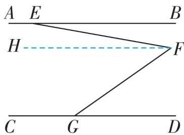

> [!success]- 必刷题
>
> > [!success] **【答案】** C
>
> > [!note]- **【解析】**
> > - **①**：同旁内角互补,两直线平行,正确,是真命题,符合题意;
> > - **②**：无理数都是无限不循环小数,正确,是真命题,符合题意;
> > - **③**：经过直线外一点有且只有一条直线与已知直线平行,故原命题错误,是假命题,不符合题意;
> > - **④**：如果一个数的立方根是这个数本身,那么这个数是0或±1,故原命题错误,是假命题,符合题意.故真命题有2个,故选C.
> >
> > 
> >
> > B 【解析】烙 3 张饼, 先烙第一张饼和第二张饼的正面, 需要 1 分钟; 再烙第一张饼的反面和第三张饼的正面, 需要 1 分钟; 最后烙第二张饼和第三张饼的反面, 需要 1 分钟. 所以, 烙好 3 张饼至少需要 3 分钟.
> >
> > 
