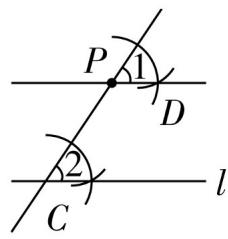
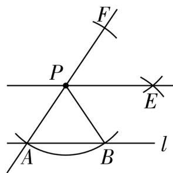

> [!success]- 必刷题
>
> > [!success] **【答案】** 甲和乙
>
> > [!note]- **【解析】**
> > 如图. 对于甲: 由作图痕迹得 $\angle 1 = \angle 2, \therefore PD // l$ , 故甲的作法正确; 对于乙: 由作图痕迹得 $PA = PB$ , $PE$ 平分 $\angle FPB$ , $\therefore \angle PAB = \angle PBA$ , $\angle FPE = \angle BPE$ . $\because \angle FPB = 180^{\circ} - \angle APB = \angle PAB + \angle PBA$ , $\therefore \angle FPE = \angle PAB$ , $\therefore PE // l$ , 故乙的作法正确. 故答案为甲和乙.
> >
> > 思路分析
> > (1) 由三角形内角和定理得 $\angle BAC = 180^{\circ} - \angle C - \angle B = 70^{\circ}$ ，从而得出 $\angle EAC$ 的度数，再求出 $\angle DAC = 90^{\circ} - \angle C = 15^{\circ}$ ，即可得出答案；
> > (2) 类比(1)中做法即可解决问题；(3)过A作 $AG \perp BC$ 于G，由(2)知， $\angle EAG = \frac{1}{2} (\angle C - \angle B)$ ，再利用平行线的判定与性质解题即可.
> >
> > 
> >
> > 
> > 乙
> > 甲
