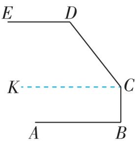

> [!success]- 必刷题
>
> > [!success] **【答案】** $128^{\circ}$
>
> > [!note]- **【解析】**
> > 如图所示, 过点 C 作 CK//AB.
> > ∵ DE // AB, ∴ CK // DE // AB. ∵ BC ⊥ AB,
> > ∴ BC ⊥ CK, ∴ ∠BCK = 90°. ∵ ∠DCB = 142°,
> > ∴ ∠DCK = ∠DCB - ∠BCK = 52°. ∵ CK // DE,
> > ∴ ∠EDC + ∠DCK = 180°, ∴ ∠EDC = 128°. 故答案为 $128^{\circ}$ .
> >
> > 
> >
> > ## 思路分析
> >
> > 过点 C 作 CK∥
> > AB, 可得 CK∥
> > DE∥AB, 再利用平行线的性质求解即可.
