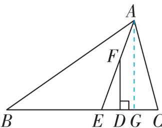

> [!success]- 必刷题
>
> > [!success] **【答案】** C
>
> > [!note]- **【解析】**
> > 【解】(1) $\because \angle C = 75^{\circ}, \angle B = 35^{\circ}, \therefore \angle BAC = 180^{\circ} - \angle C - \angle B = 70^{\circ}$ . $\because AE$ 平分 $\angle BAC$ , $\therefore \angle EAC = \frac{1}{2} \angle BAC = 35^{\circ}$ . 又 $\because AD \perp BC$ , $\therefore \angle DAC = 90^{\circ} - \angle C = 15^{\circ}, \therefore \angle EAD = \angle EAC - \angle DAC = 20^{\circ}$ .
> >
> > (2) 成立. 理由如下: $\because AE$ 平分 $\angle BAC$ , $\therefore \angle EAC = \frac{1}{2} \angle BAC$ . $\because \angle BAC = 180^{\circ} - \angle B - \angle C$ , $\therefore \angle EAC = \frac{1}{2} \angle BAC = 90^{\circ} - \frac{1}{2} \angle B - \frac{1}{2} \angle C$ , $\therefore \angle EAD = \angle EAC - \angle DAC = 90^{\circ} - \frac{1}{2} \angle B - \frac{1}{2} \angle C - (90^{\circ} - \angle C) = \frac{1}{2} (\angle C - \angle B)$ .
> >
> > (3) $\angle EFD = \frac{1}{2} (\angle C - \angle B)$ . 如图, 过 $A$ 作 $AG \perp BC$ 于 $G$ . 由 (2) 知,
> >
> > 
> >
> > $\angle EAG = \frac{1}{2} (\angle C - \angle B). \because AG \perp BC, \therefore \angle AGC = 90^{\circ}. \because FD \perp BC, \therefore \angle FDG = 90^{\circ}, \therefore \angle AGC = \angle FDG, \therefore FD \parallel AG, \therefore \angle EFD = \angle EAG,$
> >
> > 
> >
> > $$
> > \therefore \angle E F D = \frac {1}{2} (\angle C - \angle B)
> > $$
