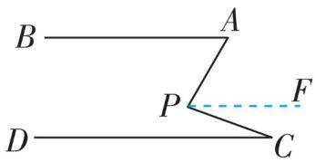
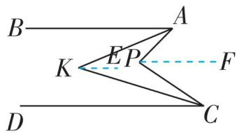
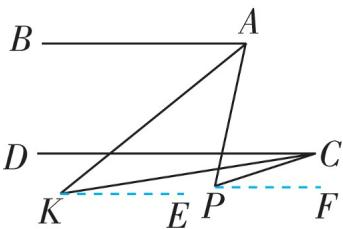

> [!success]- 必刷题
>
> > [!success] **【答案】** 详见解析
>
> > [!note]- **【解析】**
> > 【解】(1)如图(1), 过 $P$ 作 $PF \parallel AB$ . $\because AB \parallel CD$ , $\therefore PF \parallel AB \parallel CD$ , $\therefore \angle APF = \angle BAP$ , $\angle CPF = \angle DCP$ , $\therefore \angle APC = \angle APF + \angle CPF = \angle BAP + \angle DCP = 60^\circ + 20^\circ = 80^\circ$ .
> >
> > 
> >
> > 
> > 图(1)
> > 图(2)
> >
> > (2) $\angle AKC = \frac{1}{2} \angle APC$ . 理由: 如图 (2), 过 $K$ 作 $KE \parallel AB$ . $\because AB \parallel CD, \therefore KE \parallel AB \parallel CD, \therefore \angle AKE = \angle BAK, \angle CKE = \angle DCK, \therefore \angle AKC = \angle AKE + \angle CKE = \angle BAK + \angle DCK$ . 过 $P$ 作 $PF \parallel AB$ . 同理可得, $\angle APC = \angle BAP + \angle DCP$ . $\because \angle BAP$ 与 $\angle DCP$ 的平分线相交于点 $K, \therefore \angle BAK + \angle DCK = \frac{1}{2} \angle BAP+$ $\frac{1}{2}\angle DCP = \frac{1}{2} (\angle BAP + \angle DCP) = \frac{1}{2}\angle APC,$ $\therefore \angle AKC = \frac{1}{2}\angle APC.$ (3) $\angle AKC = \frac{1}{2}\angle APC.$ 理由：如图(3)，过 $K$ 作 $KE / / AB.$ $\because AB / / CD, \therefore KE / / AB / / CD,$ $\therefore \angle BAK = \angle AKE, \angle DCK =$ $\angle CKE, \therefore \angle AKC = \angle AKE - \angle CKE = \angle BAK -$ $\angle DCK.$ 过 $P$ 作 $PF / / AB.$ 同理可得， $\angle APC =$ $\angle BAP - \angle DCP.$ ∵ $\angle BAP$ 与 $\angle DCP$ 的平分线相交于点 $K, \therefore \angle BAK - \angle DCK = \frac{1}{2}\angle BAP - \frac{1}{2}\angle DCP =$ $\frac{1}{2} (\angle BAP - \angle DCP) = \frac{1}{2}\angle APC, \therefore \angle AKC =$ $\frac{1}{2}\angle APC.$
> >
> > 
> >
> > ## 综合与实践
