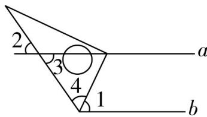

> [!success]- 必刷题
>
> > [!success] **【答案】** C
>
> > [!note]- **【解析】**
> > 如图所示，
> > ∵ $a \parallel b$ ，∴ $\angle 3 + \angle 4 + \angle 1 = 180^{\circ}$ . ∵ $\angle 4 = 60^{\circ}$ , $\angle 1 = 65^{\circ}, \therefore \angle 3 = 180^{\circ}-$ $\angle 4 - \angle 1 = 180^{\circ} - 60^{\circ} -$ $\angle 3 = 55^{\circ}.$
> >
> > 
> >
> > $$
> > \angle 4 - \angle 1 = 1 8 0 ^ {\circ} - 6 0 ^ {\circ} - 6 5 ^ {\circ} = 5 5 ^ {\circ}, \therefore \angle 2 =
> > $$
