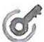
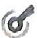

## 全章综合训练 刷中考

## 刷中考

## 考点1 认识证明

![[初中/课堂同步/教辅/必刷题/2026 八上必刷题 北师大数学/07_第七章_命题与证明/全章综合训练/questions/Q00106289.md]]
![[初中/课堂同步/教辅/必刷题/2026 八上必刷题 北师大数学/07_第七章_命题与证明/全章综合训练/questions/Q00106290.md]]
![[初中/课堂同步/教辅/必刷题/2026 八上必刷题 北师大数学/07_第七章_命题与证明/全章综合训练/questions/Q00106291.md]]

## 考点2 平行线的证明

![[初中/课堂同步/教辅/必刷题/2026 八上必刷题 北师大数学/07_第七章_命题与证明/全章综合训练/questions/Q00106292.md]]
![[初中/课堂同步/教辅/必刷题/2026 八上必刷题 北师大数学/07_第七章_命题与证明/全章综合训练/questions/Q00106293.md]]
![[初中/课堂同步/教辅/必刷题/2026 八上必刷题 北师大数学/07_第七章_命题与证明/全章综合训练/questions/Q00106294.md]]
![[初中/课堂同步/教辅/必刷题/2026 八上必刷题 北师大数学/07_第七章_命题与证明/全章综合训练/questions/Q00106295.md]]
![[初中/课堂同步/教辅/必刷题/2026 八上必刷题 北师大数学/07_第七章_命题与证明/全章综合训练/questions/Q00106296.md]]
![[初中/课堂同步/教辅/必刷题/2026 八上必刷题 北师大数学/07_第七章_命题与证明/全章综合训练/questions/Q00106297.md]]
