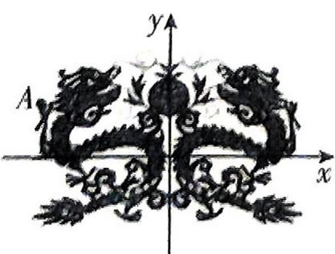
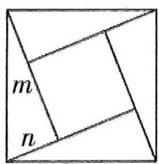

<!-- question-source:start -->
2[2024 内蒙古通辽中考]剪纸是我国民间艺术之一,如图放置的剪纸作品,它的对称轴与平面直角坐标系的坐标轴重合,则点 A(-4,2)关于对称轴对称的点的坐标为 ( )
A. (-4,-2) B. (4,-2)
C. (4,2) D. (-2,-4)

(第2题图)

(第3题图)
<!-- question-source:end -->

![[Q00106313A1]]
