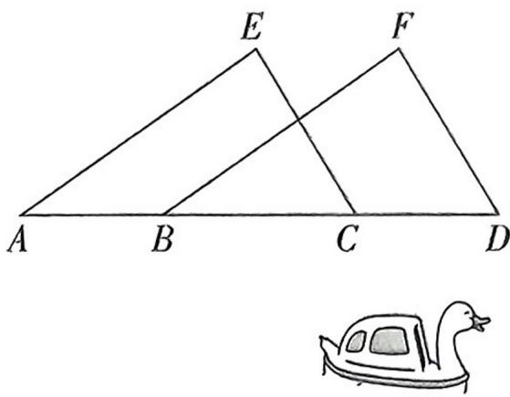

<!-- question-source:start -->
12[2024 江苏盐城中考]已知:如图,点 A,B,C,
D 在同一条直线上, $AE \parallel BF$ ,AE = BF. 若
\_\_\_\_,则 AB = CD.

请从① $CE \parallel DF$ ; ②CE = DF; ③ $\angle E = \angle F$ 这3个选项中选择一个作为条件(写序号),使结论成立,并说明理由.

轻舟已过万重山了鸦
<!-- question-source:end -->

![[Q00106323A1]]
