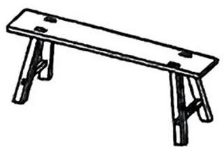
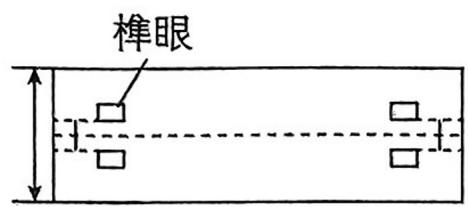
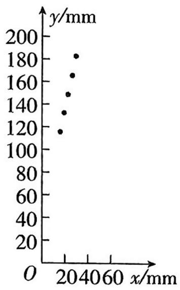

## 神奇的加密术

## 刷实践

建议用时 15 分钟 答案 D79

1. [2025 浙江温州调研]阅读下列素材：

传输信息时,需要采用密码.有一种密码的明文(真实文)是按计算机键盘字母排列的,如Q,W,E,···,N,M这26个字母依次对应1,2,3,···,25,26,如下表所示:
Q W E R T Y U I O P A S D
![[初中/课堂同步/教辅/必刷题/2026 八上必刷题 北师大数学/07_第七章_命题与证明/神奇的加密术/questions/Q00106311.md]]
![[初中/课堂同步/教辅/必刷题/2026 八上必刷题 北师大数学/07_第七章_命题与证明/神奇的加密术/questions/Q00106312.md]]

## 刷考向

## - 新考向 1 传统文化

2024 山东淄博中考]如图,其大意为已知矩形门的高比宽多6尺8寸,门的对角线长1丈,那么门的高和宽各是多少? (1 丈=10 尺,1 尺=10 寸)若设门的高和宽分别是x尺和y尺,则下面所列方程组正确的是 ( )

今有户高多于广六尺八寸. 两隅相去适一丈. 问户高、广各几何? 《九章算术》

A. $\left\{ \begin{array}{l}x = y - 6.8,\\ x^{2} + 10^{2} = y^{2} \end{array} \right.$ B. $\left\{ \begin{array}{l}x = y - 6.8,\\ x^2 +y^2 = 10^2 \end{array} \right.$ C. $\left\{ \begin{array}{l}x = y + 6.8,\\ x^2 +10^2 = y^2 \end{array} \right.$ D. $\left\{ \begin{array}{l}x = y + 6.8,\\ x^2 +y^2 = 10^2 \end{array} \right.$

![[初中/课堂同步/教辅/必刷题/2026 八上必刷题 北师大数学/07_第七章_命题与证明/神奇的加密术/questions/Q00106313.md]]
![[初中/课堂同步/教辅/必刷题/2026 八上必刷题 北师大数学/07_第七章_命题与证明/神奇的加密术/questions/Q00106314.md]]
![[初中/课堂同步/教辅/必刷题/2026 八上必刷题 北师大数学/07_第七章_命题与证明/神奇的加密术/questions/Q00106315.md]]
![[初中/课堂同步/教辅/必刷题/2026 八上必刷题 北师大数学/07_第七章_命题与证明/神奇的加密术/questions/Q00106316.md]]

## - 新考向 2 跨学科综合

![[初中/课堂同步/教辅/必刷题/2026 八上必刷题 北师大数学/07_第七章_命题与证明/神奇的加密术/questions/Q00106317.md]]
![[初中/课堂同步/教辅/必刷题/2026 八上必刷题 北师大数学/07_第七章_命题与证明/神奇的加密术/questions/Q00106318.md]]
![[初中/课堂同步/教辅/必刷题/2026 八上必刷题 北师大数学/07_第七章_命题与证明/神奇的加密术/questions/Q00106319.md]]

## - 新考向 3 开放性试题

![[初中/课堂同步/教辅/必刷题/2026 八上必刷题 北师大数学/07_第七章_命题与证明/神奇的加密术/questions/Q00106320.md]]
![[初中/课堂同步/教辅/必刷题/2026 八上必刷题 北师大数学/07_第七章_命题与证明/神奇的加密术/questions/Q00106321.md]]
![[初中/课堂同步/教辅/必刷题/2026 八上必刷题 北师大数学/07_第七章_命题与证明/神奇的加密术/questions/Q00106322.md]]
![[初中/课堂同步/教辅/必刷题/2026 八上必刷题 北师大数学/07_第七章_命题与证明/神奇的加密术/questions/Q00106323.md]]

## - 新考向 4 22 版课标新增知识点

## 代数推理

![[初中/课堂同步/教辅/必刷题/2026 八上必刷题 北师大数学/07_第七章_命题与证明/神奇的加密术/questions/Q00106324.md]]

## - 新考向 5 项目化学习

![[初中/课堂同步/教辅/必刷题/2026 八上必刷题 北师大数学/07_第七章_命题与证明/神奇的加密术/questions/Q00106325.md]]

## 【背景调查】

图(1)中的板凳又叫“四脚八叉凳”,是中国传统家具,其榫卯结构体现了古人含蓄内敛的审美观. 榫眼的设计很有讲究,木工一般用铅笔画出凳面的对称轴,以对称轴为基准向两边各取相同的长度,确定榫眼的位置,如图(2)所示. 板凳的结构设计体现了数学的对称美.

## 【收集数据】

小组收集了一些板凳并进行了测量. 设以对称轴为基准向两边各取相同的长度为 $x \mathrm{~mm}$ , 凳面的宽度为 $y \mathrm{~mm}$ , 记录如下:

<table><tr><td>以对称轴为基准向两边各取相同的长度x/mm</td><td>16.5</td><td>19.8</td><td>23.1</td><td>26.4</td><td>29.7</td></tr><tr><td>凳面的宽度y/mm</td><td>115.5</td><td>132</td><td>148.5</td><td>165</td><td>181.5</td></tr></table>

## 【分析数据】

如图(3),小组根据表中 $x, y$ 的数值,在平面直角坐标系中描出了各点.

## 【建立模型】

请你帮助小组解决下列问题：

(1) 观察上述各点的分布规律, 它们是否在同一条直线上? 如果在同一条直线上, 求出这条直线所对应的函数表达式; 如果不在同一条直线上, 说明理由.

(2)当凳面宽度为 $213 \mathrm{~mm}$ 时,以对称轴为基准向两边各取相同的长度是多少?

图(1)

图(2)

图(3)
