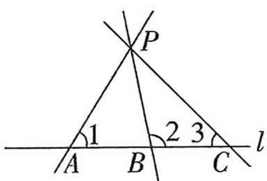

<!-- question-source:start -->
2 如图, 点 $P$ 是直线 $l$ 外一点, 过点 $P$ 画直线 $PA$ , $PB, PC$ , 分别交已知直线 $l$ 于点 $A, B, C$ , 请你用量角器量 $\angle 1, \angle 2, \angle 3$ 的度数, 并量线段 $PA$ , $PB, PC$ 的长度, 你发现的规律是 \_\_\_\_.

制发财了鸭
<!-- question-source:end -->

![[Q00106244A1]]
