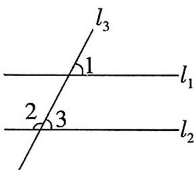

<!-- question-source:start -->
2[2024 江苏连云港期中]如图, $\angle 1$ 和 $\angle 2$ 分别为直线 $l_{3}$ 与直线 $l_{1}$ 和 $l_{2}$ 相交所成的角. 如果 $\angle 1 = 62^{\circ}$ , 那么当 $\angle 2 =$ \_\_\_\_ 时, 可判定 $l_{1} // l_{2}$ .

<!-- question-source:end -->

![[Q00106263A1]]
