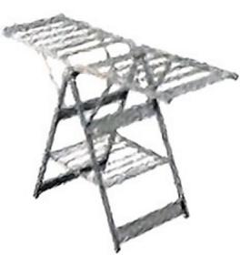
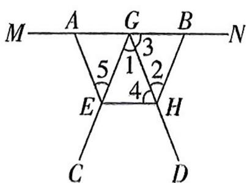

<!-- question-source:start -->
4[2025 内蒙古赤峰质检]如图(1)是生活中常见的晾衣架,将其侧面抽象成平面图形,如图(2)所示,则使 $EG \parallel BH$ 成立的条件是 ( )

A. $\angle 1 = \angle 5$ B. $\angle 1 = \angle 2$ C. $\angle 3 = \angle 4$ D. $\angle 4 = \angle 5$

图(1)

图(2)
<!-- question-source:end -->

![[Q00106265A1]]
