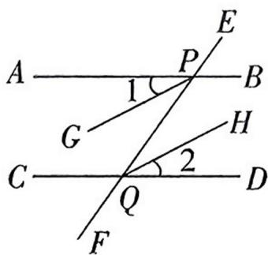

<!-- question-source:start -->
5[2024 浙江温州期末]如图, 直线 EF 分别与直线 AB, CD 相交于点 P 和点 Q, PG 平分 $\angle APQ$ , QH 平分 $\angle DQP$ , 并且 $\angle 1 = \angle 2$ , 请说出图中哪

建议用时 20 分钟 答案 D73

些直线平行,并说明理由.

<!-- question-source:end -->

![[Q00106266A1]]
