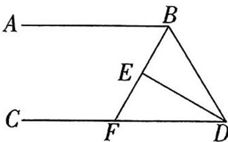

<!-- question-source:start -->
7 [2024 江西赣州质检] 如图所示, $\angle ABD$ 和 $\angle BDC$ 的平分线交于点 $E$ , $BE$ 的延长线交 $CD$ 于点 $F$ , 且 $\angle BED = 90^{\circ}$ .

(1)AB与CD平行吗？试说明理由.

(2)试探究 $\angle EFD$ 与 $\angle BDE$ 的数量关系,并说明理由.

2刷易错 小心有坑\~
<!-- question-source:end -->

![[Q00106268A1]]
