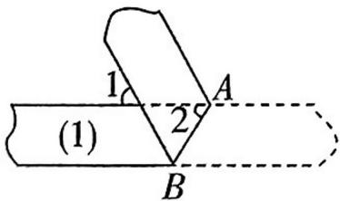
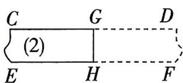

<!-- question-source:start -->
3[较难]如图,一次数学活动中,检验两条纸带(1)(2)的上下边线是否平行,明明和小丽采用两种不同的方法:明明把纸带(1)沿AB折叠,量得 $\angle 1 = \angle 2 = 60^{\circ}$ ;小丽把纸带(2)沿GH折叠,发现GD与GC重合,HF与HE重合.下列判断正确的是()

A. 纸带(1)的上下边线平行,纸带(2)的上下边线不平行
B. 纸带(1)的上下边线不平行,纸带(2)的上下边线平行
C. 纸带(1)(2)的上下边线都平行
D. 纸带(1)(2)的上下边线都不平行
<!-- question-source:end -->

![[Q00106271A1]]
