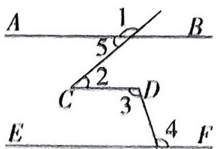

<!-- question-source:start -->
4[2024 陕西西安未央区期中, 中]如图, $\angle 1 = 140^{\circ}$ , $\angle 2 = 40^{\circ}$ , $\angle 3 = 108^{\circ}$ , 则 $\angle 4 =$ \_\_\_\_时, $AB // EF$ .

<!-- question-source:end -->

![[Q00106272A1]]
