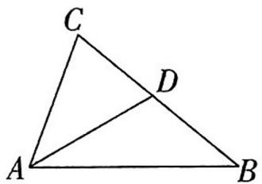
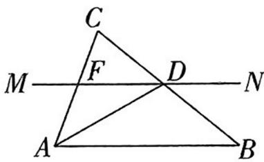

<!-- question-source:start -->
5[2024 北京东城区期末, 中] 在 $\triangle ABC$ 中, $D$ 是 $BC$ 边上一点, 且 $\angle CDA = \angle CAB$ , $MN$ 是经过点 $D$ 的一条直线. (1) 若直线 $MN \perp AC$ , 垂足为点 $E$ . ①依题意补全图(1). ②若 $\angle CAB = 70^{\circ}, \angle DAB = 20^{\circ}$ , 则 $\angle CAD =$ \_\_\_\_, $\angle CDE =$ \_\_\_\_.

(2)如图(2),若直线 MN 交 AC 边于点 F,且 $\angle CDF = \angle CAD$ ,求证: $FD \parallel AB$ .

图(1)

图(2)
<!-- question-source:end -->

![[Q00106273A1]]
