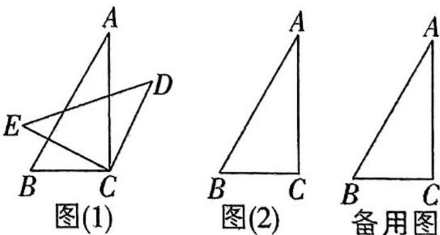
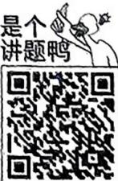

<!-- question-source:start -->
6 核心素养 几何直观 [较难] 如图(1), 将一副三角板中的两个直角顶点 $C$ 叠放在一起, 其中 $\angle A = 30^{\circ}, \angle B = 60^{\circ}, \angle D = \angle E = 45^{\circ}$ .

(1) 若 $\angle BCD = 110^{\circ}$ , 则 $\angle ACE =$ \_\_\_\_;

(2)试猜想 $\angle BCD$ 与 $\angle ACE$ 的数量关系,并说明理由;

(3)如图(2),若按住三角板 $ABC$ 不动,三角板 $DCE$ 绕顶点 $C$ 转动一周,试探究 $\angle BCD$ 等于多少度时, $CE \parallel AB$ ,请画出图,并说明理由.

<!-- question-source:end -->

![[Q00106274A1]]
