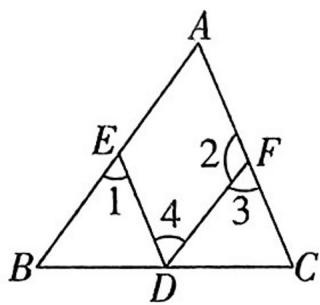
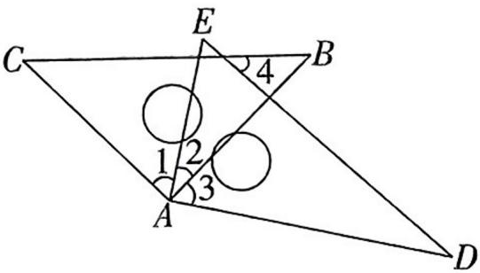

<!-- question-source:start -->
1. [2025 广东河源期末, 中]如图, 在下列给出的条件中, 不能判定 $AB \parallel DF$ 的是 ( )
A. $\angle A = \angle 3$ B. $\angle A + \angle 2 = 180^{\circ}$ C. $\angle 1 = \angle 4$ D. $\angle 1 = \angle A$

(第1题图)
(第2题图)
<!-- question-source:end -->

![[Q00106416A1]]
