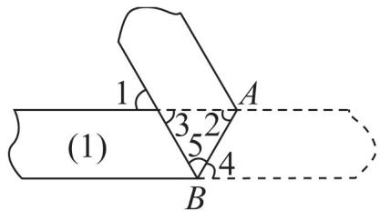

> [!success]- 必刷题
>
> > [!success] **【答案】** C
>
> > [!note]- **【解析】**
> > 如图, 在纸带(1)中, ∵ $\angle 1 = \angle 2 = 60^{\circ}$ , $\angle 3 = \angle 1 = 60^{\circ}$ , ∴ $\angle 3 = \angle 2 = 60^{\circ}$ , ∴ $\angle 4 = \angle 5 = 180^{\circ} - 60^{\circ} - 60^{\circ} = 60^{\circ}$ , ∴ $\angle 2 = \angle 4$ , ∴ 纸带(1)的上下边线平行. 在纸带(2)中, ∵ GD 与 GC 重合, HF 与 HE 重合, ∴ $\angle CGH = \angle DGH = 90^{\circ}$ , $\angle EHG = \angle FHG = 90^{\circ}$ , ∴ $\angle CGH + \angle EHG = 180^{\circ}$ , ∴ 纸带(2)的上下边线平行.
> >
> > 
