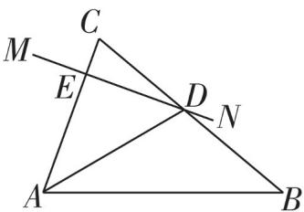

> [!success]- 必刷题
>
> > [!success] **【答案】** $50^{\circ}, 30^{\circ}
>
> > [!note]- **【解析】**
> > (1)【解】①如图所示.
> >
> > 关键点拨由折叠的性质得到 $\angle GFH = \angle \alpha$ 是解题的关键.
> >
> > 
> > - **②**：∵ $\angle CAB = 70^{\circ}, \angle DAB = 20^{\circ}, \therefore \angle CAD = 50^{\circ}.$ ∵ $\angle CDA = \angle CAB = 70^{\circ}, \therefore \angle C = 180^{\circ} - \angle CAD - \angle CDA = 60^{\circ}.$ ∵ $DE \perp AC, \therefore \angle CDE = 90^{\circ} - \angle C = 30^{\circ}.$ 故答案为 $50^{\circ}, 30^{\circ}.$
> >
> > (2)【证明】∵ $\angle CDA = \angle CAB, \therefore \angle CDF + \angle ADF = \angle CAD + \angle BAD.$ ∵ $\angle CDF = \angle CAD,$ ∴ $\angle ADF = \angle BAD, \therefore FD \parallel AB.$
> >
> > ## 刷素养·
