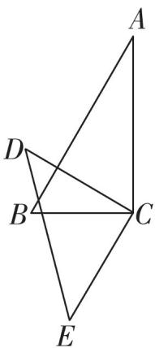
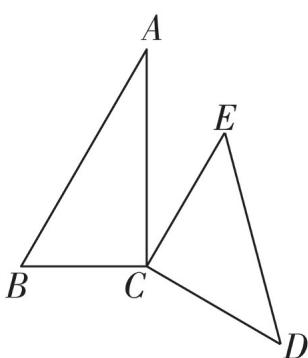

> [!success]- 必刷题
>
> > [!success] **【答案】** $70^{\circ}$
>
> > [!note]- **【解析】**
> > 【解】(1) $\because \angle BCD = \angle ACB + \angle ACD = 90^{\circ} + \angle ACD, \therefore \angle BCD + \angle ACE = 90^{\circ} + \angle ACD + \angle ACE = 90^{\circ} + 90^{\circ} = 180^{\circ}. \because \angle BCD = 110^{\circ}, \therefore \angle ACE = 70^{\circ}$ . 故答案为 $70^{\circ}$ .
> >
> > (2) $\angle BCD + \angle ACE = 180^{\circ}$ . 理由如下: $\because \angle BCD = \angle ACB + \angle ACD = 90^{\circ} + \angle ACD,$ $\therefore \angle BCD + \angle ACE = 90^{\circ} + \angle ACD + \angle ACE = 90^{\circ} + 90^{\circ} = 180^{\circ}$ .
> >
> > (3) ① 如图 (1) 所示, 当 $\angle BCD = 30^{\circ}$ 时, $AB//CE$ .
> >
> > 理由: $\because \angle BCD = 30^{\circ}, \angle DCE = 90^{\circ},$ $\therefore \angle BCE = \angle B = 60^{\circ}, \therefore AB//CE.$
> >
> > 
> >
> > 
> > 图(1)
> > 图(2)
> > - **②**：如图(2)所示,当 $\angle BCD=150^{\circ}$ 时, $AB//CE$ .理由: $\because \angle BCD=150^{\circ}, \angle ACB=\angle ECD=90^{\circ}, \therefore \angle ACE=30^{\circ}, \therefore \angle A=\angle ACE=30^{\circ}, \therefore AB//CE.$
> >
> > ## 课时 2 平行线的性质
