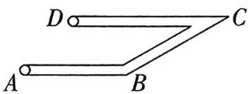

## 课时 1 平行线的判定 刷基础

电子错题本鸭

## 刷基础

## 知识点 1 用 “同位角相等” 判定两直线平行

![[初中/课堂同步/教辅/必刷题/2026 八上必刷题 北师大数学/07_第七章_命题与证明/课时_1_平行线的判定/questions/Q00106262.md]]
![[初中/课堂同步/教辅/必刷题/2026 八上必刷题 北师大数学/07_第七章_命题与证明/课时_1_平行线的判定/questions/Q00106263.md]]
![[初中/课堂同步/教辅/必刷题/2026 八上必刷题 北师大数学/07_第七章_命题与证明/课时_1_平行线的判定/questions/Q00106264.md]]

## 知识点 2 用 “内错角相等” 判定两直线平行

![[初中/课堂同步/教辅/必刷题/2026 八上必刷题 北师大数学/07_第七章_命题与证明/课时_1_平行线的判定/questions/Q00106265.md]]
![[初中/课堂同步/教辅/必刷题/2026 八上必刷题 北师大数学/07_第七章_命题与证明/课时_1_平行线的判定/questions/Q00106266.md]]

## 知识点 3 用 “同旁内角互补” 判定两直线平行

![[初中/课堂同步/教辅/必刷题/2026 八上必刷题 北师大数学/07_第七章_命题与证明/课时_1_平行线的判定/questions/Q00106267.md]]
![[初中/课堂同步/教辅/必刷题/2026 八上必刷题 北师大数学/07_第七章_命题与证明/课时_1_平行线的判定/questions/Q00106268.md]]

## 易错点 不能准确识别截线和被截线，从而误判两直线平行

![[初中/课堂同步/教辅/必刷题/2026 八上必刷题 北师大数学/07_第七章_命题与证明/课时_1_平行线的判定/questions/Q00106269.md]]
