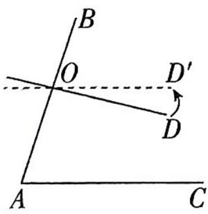
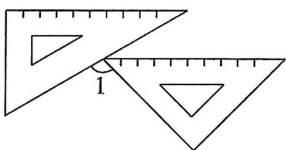

<!-- question-source:start -->
3[2025 陕西西安期中]如图, $\angle A = 72^{\circ}, O$ 是 $AB$ 上一点, 直线 $OD$ 与 $AB$ 的夹角 $\angle BOD = 85^{\circ}$ , 要使 $OD \parallel AC$ , 直线 $OD$ 绕点 $O$ 逆时针旋转的度数最小为 \_\_\_\_.

(第3题图)

(第4题图)
<!-- question-source:end -->

![[Q00106276A1]]
