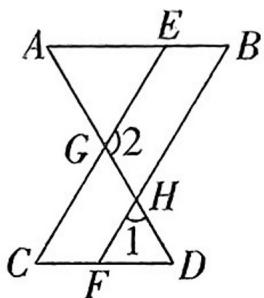

<!-- question-source:start -->
6 如图, 点 E 在 AB 上, 点 F 在 CD 上, CE, BF 分别交 AD 于点 G, H, 已知 $\angle A = \angle AGE$ , $\angle D = \angle DGC$ .

(1)AB与CD平行吗？请说明理由.

(2) 若 $\angle 2 + \angle 1 = 180^{\circ}$ , 且 $\angle BEC = 2\angle B + 30^{\circ}$ , 求 $\angle C$ 的度数.

<!-- question-source:end -->

![[Q00106279A1]]
