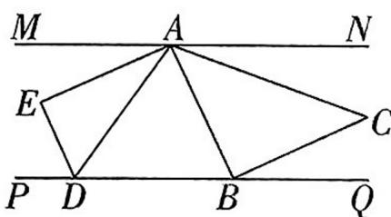

<!-- question-source:start -->
8[2024 贵州六盘水期末]如图, $MN \parallel PQ$ , 将两个直角三角形按如下方式进行摆放, 其中 $\angle E = \angle ABC = 90^{\circ}, \angle EAD = 30^{\circ}, \angle BAC = 45^{\circ}$ 恰好满足 $\angle NAC = 20^{\circ}, \angle MAE = \angle CBQ$ .

(1) 求 $\angle CBQ$ 的度数;

(2)试判断 $AB$ 与 $DE$ 的位置关系,并说明理由.

<!-- question-source:end -->

![[Q00106281A1]]
