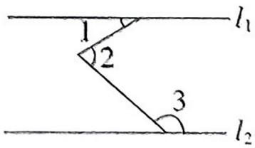

<!-- question-source:start -->
9 如图, 直线 $l_{1} / / l_{2}, \angle 1 = 30^{\circ}$ , 则 $\angle 2 + \angle 3 =$ ( )

A. $150^{\circ}$ B. $180^{\circ}$ C. $210^{\circ}$ D. $240^{\circ}$

<!-- question-source:end -->

![[Q00106282A1]]
