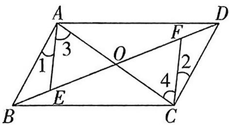
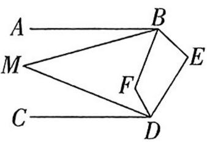

<!-- question-source:start -->
1. [2024 河北衡水期中, 中]如图, 四边形 $ABCD$ $\text{, } BD$ 与 $AC$ 相交于点 $O, AE \parallel CF, E, F$ 在 $BD$ 上, 下列条件中能推出 $AB \parallel CD$ 的是 ( )

A. $\angle 1 = \angle 2$ B. $\angle 3 = \angle 4$ C. $\angle DAE = \angle BCF$ D. $\angle BAD = \angle DCB$

(第1题图)

(第2题图)
<!-- question-source:end -->

![[Q00106283A1]]
