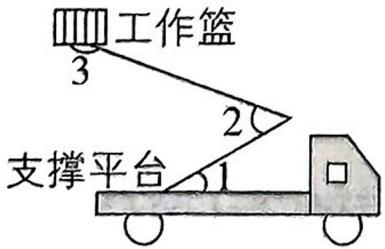
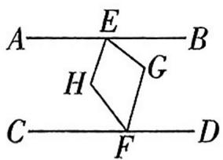

<!-- question-source:start -->
3[2024 黑龙江鸡西质检, 中]如图是路政工程车的工作示意图, 工作篮底部与支撑平台平行. 若 $\angle 1 = 30^{\circ}, \angle 2 = 50^{\circ}$ , 则 $\angle 3$ 的度数为 \_\_\_\_.

(第3题图)

(第4题图)
<!-- question-source:end -->

![[Q00106285A1]]
