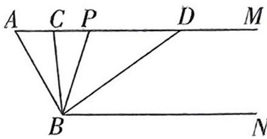

<!-- question-source:start -->
5[较难]如图,已知 $AM \parallel BN$ , $\angle A = 60^{\circ}$ , 点 $P$ 是射线 $AM$ 上一动点 (不与点 $A$ 重合), $BC$ , $BD$ 分别平分 $\angle ABP$ 和 $\angle PBN$ , 交射线 $AM$ 于点 $C, D$ . (1) 求 $\angle CBD$ 的度数.

(2) 当点 $P$ 运动时, $\angle APB$ 与 $\angle ADB$ 的度数之比是否随之发生变化? 若不变, 请求出这个比; 若变化, 请找出变化规律.

(3) 当点 $P$ 运动到使 $\angle ACB = \angle ABD$ 的位置时, 求 $\angle ABC$ 的度数.

<!-- question-source:end -->

![[Q00106287A1]]
