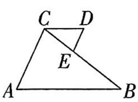
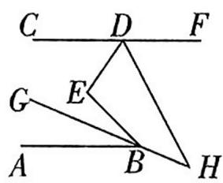
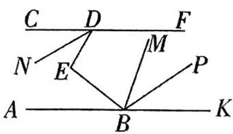
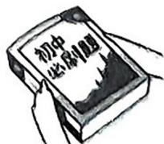

<!-- question-source:start -->
6 核心素养 几何直观 [2024 山东济南期末,较难]
(1)如图(1),E点在BC上, $\angle A=\angle D,\angle ACB+\angle BED=180^{\circ}$ . 求证:AB//CD.
(2)如图(2),AB//CD,BG平分∠ABE,直线GB与∠EDF的平分线交于H点,若∠DEB比∠DHB大60°,求∠DEB的度数.
(3)如图(3),AB//CD,∠DEB的度数与(2)中求出的相同,BM平分∠EBK,DN平分∠CDE,作BP//DN,求∠PBM的度数.

图(1)

图(2)

图(3)

公主王子请刷默鸭

是个新“烤”鸭

电子错题本鸭
<!-- question-source:end -->

![[Q00106288A1]]
