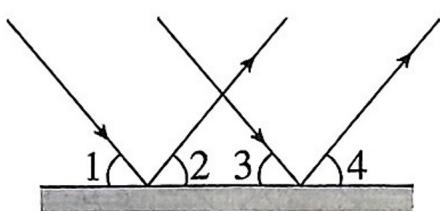
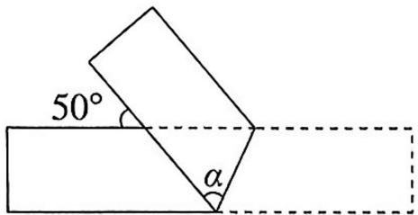

<!-- question-source:start -->
1. 新考向 跨学科综合 [2025 广东深圳质检] 如图, 一束平行光线照射平面镜后反射 (注: 入射角 $\angle 1 =$ 反射角 $\angle 2$ ), 若入射光线与平面镜夹角 $\angle 1 = 50^{\circ}$ , 则反射光线与平面镜夹角 $\angle 4$ 的度数为 ( )
A. $40^{\circ}$ B. $50^{\circ}$ C. $60^{\circ}$ D. $70^{\circ}$

(第1题图)

(第2题图)
<!-- question-source:end -->

![[Q00106417A1]]
