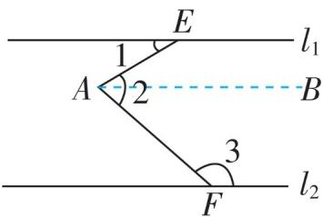

> [!success]- 必刷题
>
> > [!success] **【答案】** C
>
> > [!note]- **【解析】**
> > 0 ^ {\circ}, \angle F A B + \angle 3 = 1 8 0 ^ {\circ}
> > $$
> >
> > 
> >
> > $\therefore \angle 2 + \angle 3 = \angle EAB + \angle FAB + \angle 3 = 210^{\circ}$ .
> >
> > 故选 **C**.
