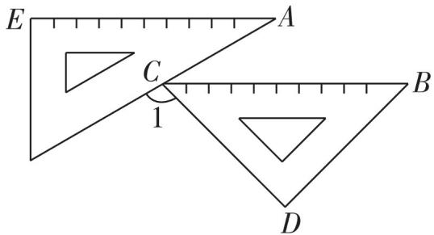

> [!success]- 必刷题
>
> > [!success] **【答案】** C
>
> > [!note]- **【解析】**
> > 如图,由题意得 $\angle A = 30^{\circ}, \angle BCD = 45^{\circ} \therefore AE \parallel BC, \therefore \angle ACB = \angle A = 30^{\circ}, \therefore \angle 1 = 180^{\circ} - \angle ACB - \angle BCD = 105^{\circ}$ . 故选 C.
> >
> > 
> >
> > 思路分析
> > 由题意可得 $\angle A = 30^{\circ}$ , $\angle BCD = 45^{\circ}$ ,
> > 由平行线的性质可得 $\angle ACB=30^{\circ}$ ，利用平角的定义即可求得 $\angle1$ 的大小.
