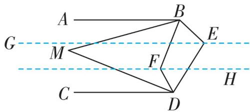

> [!success]- 必刷题
>
> > [!success] **【答案】** C
>
> > [!note]- **【解析】**
> > - **①**：如图, 过点 E 作 EG//AB, 过点 F //H//AB, 则 AB//EG//FH//CD, 所以 ∠ABE+ ∠BEG = 180°, ∠CDE + ∠DEG = 180°, 所以 ∠ABE + ∠BEG + ∠CDE + ∠DEG = 360°, 即 ∠ABE + ∠BED + ∠CDE = 360°, 故①正确.
> > - **②**：因为 ∠BED = 80°, ∠ABE + ∠BED + ∠CDE = 360°, 所以 ∠ABE + ∠CDE = 280°. 因为 AB // FH // CD, 所以 ∠ABF = ∠BFH, ∠CDF = ∠DFH, 所以 ∠BFD = ∠BFH + ∠DFH = ∠ABF + ∠CDF = $\frac{1}{2}$ (∠ABE + ∠CDE) = 140°,
> >
> > 故②正确. ③同理可得, ∠BMD = ∠ABM + ∠CDM = $\frac{1}{3}$ (∠ABF + ∠CDF), 所以 6∠BMD = 2 (∠ABF + ∠CDF) = ∠ABE + ∠CDE, 所以 6∠BMD + ∠BED = 360°, 故③正确. ④由题意无法判断 ④是否正确, 所以 ①②③正确. 故选 C.
> >
> > 
